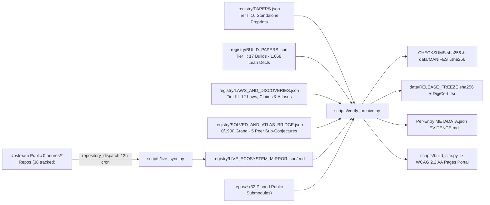

# Archive Architecture (`docs/architecture.md`)

`0thernes-research-archive` is the **single canonical public master hub** organizing all public scientific outputs authored by Alexander Stephen Donahue (`ORCID 0009-0006-8168-9648`) into **three strictly separated epistemic tiers** (**45 entries**: 16 Tier I + 17 Tier II + 12 Tier III), backed by **32 pinned public Git submodules** under `repos/`, a **26-row Solved Sub-Conjectures & Mega-Atlas V2 Bridge**, a **Real-Time Live Upstream Ecosystem Mirror** (`38` unique public repositories), a unified SHA-256 integrity manifest (`CHECKSUMS.sha256` & `data/MANIFEST.sha256`), and an immutable DigiCert RFC 3161 TSA–sealed frozen release manifest (`data/RELEASE_FREEZE.sha256` + `data/RELEASE_FREEZE.sha256.tsr`).

## Verification Invariants

1. **Single-script deterministic derivation (`scripts/verify_archive.py --sync`):** Regenerates all `METADATA.json`, `EVIDENCE.md`, `registry/*.md`, `CHECKSUMS.sha256`, `data/MANIFEST.sha256`, and `data/RELEASE_FREEZE.sha256` directly from the canonical JSON registries (verified idempotent by B14 tests).
2. **Real-time live upstream mirror (`scripts/live_sync.py` + `.github/workflows/live-sync.yml`):** Tracks live `main` HEADs, latest releases, and CI status across all **38** public non-fork `0thernes/*` repositories without disturbing immutable release-pinned frozen PDFs or invalidating `data/RELEASE_FREEZE.sha256.tsr`.
3. **Exact submodule commit pinning, table continuity & A24 size caps:** Every `pinned_commit` in `PAPERS.json` and `BUILD_PAPERS.json` matches `git ls-files --stage repos` (`32` submodules), `README.md` registry tables cannot be split by blank lines, `README.md` and `LIVE_ECOSYSTEM_MIRROR.json` counts match exact registry totals, `SOLVED_AND_ATLAS_BRIDGE.json` enforces exact version parity against the registries, and every archived file is strictly `< 5 MB`.
4. **Strict axiom, identity, link, TSA & ORCID enforcement:** Every entry carries ORCID `0009-0006-8168-9648`, zero unformed `"0thernes LLC"` assertions, an explicit `verification_boundary`, Lean axiom allowlists strictly within `[propext, Classical.choice, Quot.sound]`, valid DigiCert RFC 3161 TSA digest binding, and zero broken relative markdown links.
5. **Public-only privacy firewall:** Zero private repositories or third-party forks may appear anywhere in `registry/`, `repos/`, `llms.txt`, or `.gitmodules`.
