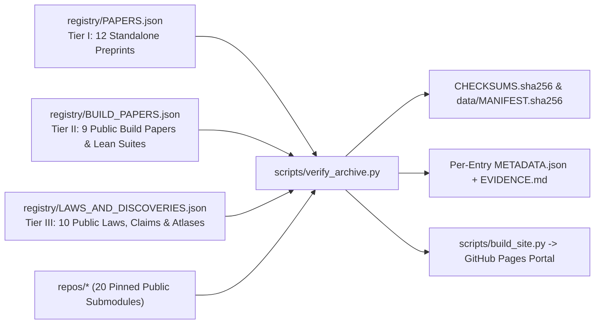

# Archive Architecture (`docs/architecture.md`)

`0thernes-research-archive` organizes all public scientific outputs authored by Alexander Stephen Donahue (`ORCID 0009-0006-8168-9648`) into **three strictly separated epistemic tiers**, backed by **20 pinned public Git submodules** under `repos/` and a unified SHA-256 integrity manifest (`CHECKSUMS.sha256` & `data/MANIFEST.sha256`).

## Verification Invariants

1. **Single-script deterministic derivation (`scripts/verify_archive.py --sync`):** Regenerates all `METADATA.json`, `EVIDENCE.md`, `registry/*.md`, and `CHECKSUMS.sha256` directly from the three canonical JSON registries.
2. **Exact submodule commit pinning:** Every `pinned_commit` in `PAPERS.json` and `BUILD_PAPERS.json` is cross-checked against `git ls-files --stage repos`.
3. **Strict axiom & ORCID enforcement:** Every entry must carry ORCID `0009-0006-8168-9648`, an explicit `verification_boundary`, and Lean axiom allowlists strictly within `[propext, Classical.choice, Quot.sound]`.
4. **Public-only privacy firewall:** Zero private repositories or third-party forks may appear in `registry/` or `.gitmodules`.
